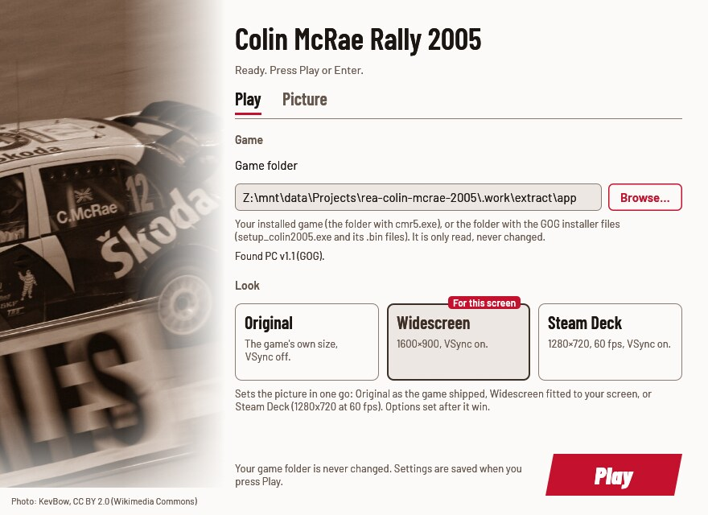
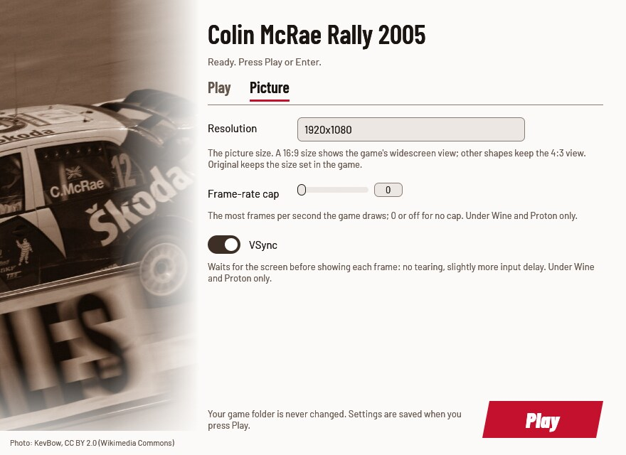
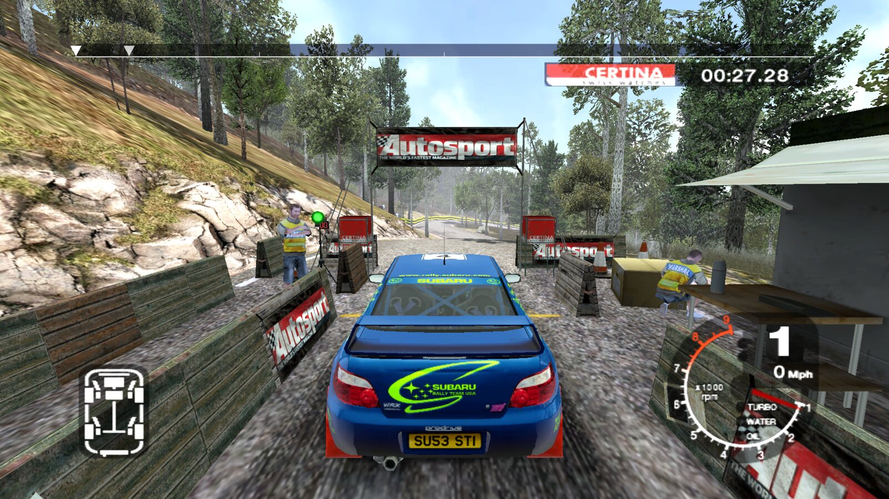

# Colin McRae Rally 2005 Launcher

Plays **your own copy** of Colin McRae Rally 2005 on Windows 10/11, the
Steam Deck and Linux (Proton, Wine or the AppImage). Point it at your game,
or at the GOG installer you downloaded, and press **Play**. Everything the
game needs is bundled and set up for you: no patchers, no winetricks, no
DLL overrides, no registry edits by hand. Your game folder is only read,
never changed; the launcher plays from a private copy.

This project contains no game files: you need your own copy of the game.

> Played end to end on Linux with the AppImage and with Wine 11 inside
> gamescope: unpacking the GOG installer, the intro videos, the menus and
> a stage, every look, quitting by closing the window, a gamepad set up in
> the game's menu. Not tested yet: Windows itself, the Steam Deck and
> Proton. Reports are welcome:
> [open an issue](https://github.com/akitaonrails/rea-colin-mcrae-2005/issues/new?template=bug-report.yml).

[](https://new-uploads-akitaonrails.s3.us-east-2.amazonaws.com/2026/11/02/colin-mcrae-rally-2005/showcase-h264.mp4)

*From the launcher to a Finland stage in the Impreza, at 4K on Linux with a gamepad. Click to watch (3:03, with sound).*

## Problems this launcher solves

| Problem | What the launcher does |
| --- | --- |
| On Linux the game crashes as soon as it starts, before the first menu (the "Wine dead-end"). | The game looks for its files through settings its installer writes. Without them it loads no fonts and crashes. The launcher writes them on every start, pointing at its private copy. |
| GOG's installer hangs under Wine, so Linux players can't install the game at all. | Point the launcher at the installer files. It unpacks the game itself on the first start (with innoextract, bundled) and never runs the installer. |
| The game starts at 640×480 in the corner of the screen. | The picture follows your screen: the **Widescreen** look uses the largest 16:9 size that fits, with the game's own widescreen view. |
| Under Wine a stage runs at about 20 frames per second. | The launcher brings DXVK for Wine and Proton: the same stage runs at hundreds of frames per second, with a frame-rate cap and VSync you can set. |
| Alt+F4 and the window's close button do nothing, so the game had to be killed. | Closing the window (or Super+W, or your desktop's close shortcut) ends the game and the launcher. |
| The game's **Advanced particles** option is greyed out on AMD and on any Intel processor made after 2004: the game offers it only on a Pentium 4 with Hyper-Threading. | The launcher starts the game with its own `FORCEHT` switch, so the option is there on every processor (on by default). |
| When the game can't use the picture size it was given, or finds another graphics card, it quietly drops to 640×480 and resets every Graphics option. | After the game exits the launcher notices, puts your graphics options back and says why. |
| Saves sit inside the game folder, and copying or patching the game risked them. | Your saves get a folder of their own, outside the game and the launcher's copy. Saves already in your game folder are copied there once. |

## Screenshots

| Play | Picture |
| --- | --- |
|  |  |



## What you need

- Colin McRae Rally 2005 for PC, the **GOG** release (version 1.1). Either
  the installed game, the folder with `cmr5.exe`, or the folder with the
  three installer files you downloaded from GOG (`setup_colin2005.exe`,
  `setup_colin2005-1.bin`, `setup_colin2005-2.bin`).
- About 3.9 GB free if you start from the installer files: the launcher
  unpacks the game once, into a folder of its own (see **Where things
  are**). The installer is never run and its folder is only read; any
  other installer is left alone and reported.
- The retail DVD versions use StarForce copy protection and are not
  supported.

If your `cmr5.exe` or `setup_colin2005.exe` is a version the launcher does
not know, it stops and shows a code (SHA-256). Please
[report it](https://github.com/akitaonrails/rea-colin-mcrae-2005/issues/new?template=unknown-edition.yml)
with that code and where your copy came from. Report the code, never the
file itself.

## Download and install

Download from the [latest release](https://github.com/akitaonrails/rea-colin-mcrae-2005/releases/latest):
`CMR2005Launcher-<version>.zip` for Windows, Proton and your own Wine, or
`CMR2005Launcher-<version>-x86_64.AppImage` for Linux.

### Windows

1. Unzip anywhere outside the game folder.
2. Keep the `components` folder next to `CMR2005Launcher.exe`.
3. Run `CMR2005Launcher.exe`.

The launcher is unsigned, so the first start from a downloaded zip may
show "Windows protected your PC": click *More info*, then *Run anyway*.

### Steam Deck

1. In Desktop Mode, keep the AppImage (or unzip the zip) somewhere in your
   home folder.
2. Steam → **Add a Non-Steam Game** → choose it. For the zip's
   `CMR2005Launcher.exe`, open its Properties → Compatibility and force a
   Proton version.
3. Back in Game Mode, start it. The **Steam Deck** look is picked for you.

Game Mode has not been tested yet.

### Linux: AppImage

```sh
chmod +x CMR2005Launcher-*-x86_64.AppImage
./CMR2005Launcher-*-x86_64.AppImage
```

It brings its own Wine and keeps its Wine prefix in
`~/.local/share/cmr2005-launcher/prefix`. When gamescope is installed the
game runs inside it. Your Linux files are drive `Z:` in the window.

### Linux: Steam (Proton)

Add the zip's `CMR2005Launcher.exe` as a non-Steam game and force a Proton
version, as on the Steam Deck. Proton brings its own DXVK. Not tested yet.

### Linux: your own Wine

From the zip:

```sh
linux/cmr2005-play            # the settings window, then the game
linux/cmr2005-play --play     # the game with your saved settings
linux/cmr2005-play stop       # end the game
linux/cmr2005-play status     # running or idle
```

More, including a distrobox, in [linux/README.md](linux/README.md).

## First run

1. Press **Browse…** and choose the folder with `cmr5.exe`, or the folder
   with GOG's `setup_colin2005.exe`. Under Wine your Linux files are drive
   `Z:`, for example `Z:\home\you\Games\Colin McRae Rally 2005`.
2. Pick a look. **Widescreen** is recommended (**Steam Deck** on a Deck).
3. Press **Play** (or Enter).

From the installer files, the first start unpacks the game, about 3.6 GB,
with the bundled innoextract, in a window that shows the progress and the
time left (about three minutes in testing). **Stop unpacking** (or Escape,
or the pad's B) stops it and leaves nothing behind. The installer itself
is never run, and its files are only read. Once the game is unpacked, the
**Game folder** setting points at the unpacked folder, so later starts are
quick and the installer files are no longer needed (`launcher.log` says
so). When the folder came from `--game` on the command line, the setting
is left as it is and the log names the unpacked folder to use instead.

Then set up the game itself in its own **Options** menu: the graphics
detail and effects, and your gamepad (see **Gamepad** below). The
resolution is the one exception: the launcher sets it on every start from
your look (or the Picture tab), so change it in the launcher. To keep the
resolution you pick in the game, choose the **Original** look.

## The settings window

**Play** holds the game folder and the looks. **Picture** holds the
resolution, the frame-rate cap, VSync and Advanced particles. **Wheel**
sets up a wheel and pedals (see **Wheels**). Changing one
of the first three by hand leaves the look cards unselected (your own mix);
Advanced particles is not part of a look.

| Look | Resolution | Frame-rate cap | VSync | When to pick it |
| --- | --- | --- | --- | --- |
| **Original** | the game's own (it starts at 640×480) | none | off | to see the game as it shipped |
| **Widescreen** | the largest 16:9 size that fits your screen, widescreen view | 60 fps | on | most screens (picked on the first run) |
| **Steam Deck** | 1280×720, widescreen view | 60 fps | on | the Deck (picked there on the first run) |

The game's widescreen view is only correct at 16:9 sizes. Other shapes
(16:10, 21:9, 4:3) keep the game's 4:3 view.

The cap is 60 frames per second because the game's animations are timed to
its frame rate; at higher rates driver animations can look wrong. Raise the
cap in the Picture tab if you want more frames.

The window works with the keyboard alone: Tab moves, Enter or Space
activates, Enter plays. A control that can't be used says why.

## Gamepad

The launcher adds nothing for pads: the game reads them itself. Set yours
up once in the game's **Options**, in its controller settings: choose the
pad, then the buttons and the steering and pedal axes. A gamepad
was set up this way and played a full stage on Linux. The same screen
calibrates the axes (**deadzone** and **saturation**) and holds the
**Vibration** and **Vibration Strength** settings.

## Wheels

The game reads one controller per player and knows nothing of today's
wheels: a 900–1080° wheel turns the car fully at a few degrees, and
pedals on their own USB device can't be used beside the wheel. The
launcher's copy of the game therefore loads `rea_dinput.dll`, which shows
the game **one wheel, "rea wheel"**, made from your wheel and your pedals:

- the steering after the **steering lock** you pick, so the car turns as
  far as your hands do (540° by default, a rally lock);
- throttle and brake on axes of their own, from pedals in the wheel base
  or on their own USB (Fanatec, Heusinkveld, Simucube…);
- the wheel's buttons, then the pedals', and the wheel's hat;
- force feedback from the game, sent to your wheel at your strength, and
  back after the wheel was replugged.

**Setup:** plug the wheel and pedals in, open the launcher's **Wheel** tab
and check the **Live check**: turn the wheel, press each pedal. If a pedal
reads wrong, press **Calibrate pedals** and follow the steps. Then Play.
With **Wheel support** on Auto, the launcher sets the game's controls for
"rea wheel" when a wheel is plugged in as you press Play: player 1 drives
with it, steering on X, accelerate and brake on their own pedals, force
feedback on, autocentre off. Your own changes to those controls in the
game's **Options → Controllers** are kept from then on. Started without
the wheel, the game gets back the controller it had before (your pad,
as you set it up), and the wheel's settings come back with the wheel.

**There is nothing to set up before the game first saves.** The game
writes its settings file (`saves\OPTIONS`) when it saves for the first
time; until then the launcher has nothing to change, and the wheel is set
up in the game's controls from the next start. On that first start, bind
"rea wheel" in **Options → Controllers** yourself, or just start the game
again.

- **Steering lock:** set it in the Wheel tab, and leave your wheel's own
  software at its full rotation (900° or more); the tab's lock does the
  rest. Setting both makes the lock smaller than you chose.
- **Force feedback:** the tab's **Strength** scales what the game sends.
  Start lower on a direct-drive base. **Test force feedback** pushes the
  wheel left, then right.
- **Fanatec pedals on USB** (ClubSport, CSL): they show up as their own
  device; the tab finds them, or pick them under **Pedals**. Pedals
  plugged into the base work as they are.
- **Wheels in Xbox mode** (G920/G923 Xbox, T248X…): switch the wheel to
  its PC mode, or turn its "gamepad" mode off in the vendor software; in
  Xbox mode it looks like a pad and is not used as a wheel.
- **Off:** set **Wheel support** to Off (or `--wheel off`) and the game
  sees your controllers as they are.

Limits: the game reads 256 steps of steering whatever the wheel; the
wheel and pedals are picked when the game starts (a replug of the same
wheel is fine, a new wheel needs a restart); one wheel, for player 1.
Real wheels have not been tried yet (see
[docs/RUNTIME_NOTES.md](docs/RUNTIME_NOTES.md)).

## The game's own settings

The launcher sets the picture size and, under Wine and Proton, the frame-rate
cap and VSync. Everything else belongs to the game, in its own **Options**:

- **Options → Graphics** has **Advanced particles** (on/off; the
  launcher's **Advanced particles** switch makes the game offer it on any
  processor). **Advanced Options** has **Post processing effects**, **Texture Quality**, **Environment
  Map**, **Shadows**, **Draw Distance**, **FSAA**, **Anisotropic filtering**
  and **Environmental Audio (EAX) 4.0**. If a detail or an effect is missing,
  look there first; the launcher does not change those settings (it only
  puts them back after the game reset them, see **Troubleshooting**).
- **Vsync** and **Refresh Rate** are in the advanced display options. On
  Windows these are the settings to use: the launcher's frame-rate cap and
  VSync work under Wine and Proton only.
- **Options → Controllers** chooses and calibrates the pad (deadzone,
  saturation) and holds the vibration settings.

EAX 4.0 is the game's own audio option and needs a Creative driver or an
EAX wrapper such as DSOAL; modern Windows and Wine provide neither, and the
launcher does not bundle one.

## Options

Every option has the same name in the window, in `launcher.cfg` and as a
flag (`fps_limit` in the file is `--fps-limit` on the command line).
`launcher.cfg` is described under **Where things live**. The first run
writes it with every option commented and the recommended look's values
filled in.

| `launcher.cfg` / flag | In the window | Values | Unset | What it changes |
| --- | --- | --- | --- | --- |
| `game` / `--game` | Play: Game folder | a folder | asked in the window | Your installed game, or the folder with GOG's installer files (unpacked once, never run; the setting then points at the unpacked folder). Only read. |
| `look` / `--look` | Play: the look cards | `original`, `widescreen`, `steam_deck` | none | Sets the resolution, cap and VSync at once; options set after it win. |
| `resolution` / `--resolution` | Picture: Resolution | `WIDTHxHEIGHT`, `original` | the game's own | The picture size. A 16:9 size gets the widescreen view. |
| `fps_limit` / `--fps-limit` | Picture: Frame-rate cap | `0`–`1000`, `off` | no cap | The most frames per second. 60 keeps the game's animations steady. Under Wine and Proton only. |
| `vsync` / `--vsync` | Picture: VSync | `on`, `off` | the game's own | Waits for the screen: no tearing. Under Wine and Proton only. |
| `advanced_particles` / `--advanced-particles` | Picture: Advanced particles | `on`, `off` | on | Starts the game with `FORCEHT`, which makes its Advanced particles option available on any processor (it starts on; turn it off here or in the game). Heavy snow on the Swedish stages can hide the road with them on. |
| `wheel` / `--wheel` | Wheel: Wheel support | `auto`, `on`, `off` | auto | Auto: when a wheel is plugged in as the game starts, the game sees one wheel made from it and your pedals ("rea wheel"), already set up in its controls. On: always. Off: the game sees your controllers as they are. |
| `wheel_device` / `--wheel-device` | Wheel: Wheel | a DirectInput instance GUID | picked for you | The wheel to drive with. |
| `wheel_pedals` / `--wheel-pedals` | Wheel: Pedals | a DirectInput instance GUID | the calibrated pedals, else the wheel's own | Pedals on their own USB device. |
| `wheel_lock` / `--wheel-lock` | Wheel: Steering lock | `180`, `270`, `360`, `540`, `900`, `full` | 540 | How far you turn the wheel for full lock in the game. |
| `wheel_deadzone` / `--wheel-deadzone` | Wheel: Deadzone | `0`–`25` (percent) | 0 | A band in the centre that does nothing, for a wheel that drifts. |
| `wheel_curve` / `--wheel-curve` | Wheel: Curve | `0`–`100` | 0 (linear) | Softens small turns near the centre. |
| `wheel_invert_throttle` / `--wheel-invert-throttle` | Wheel: Invert throttle | `on`, `off` | off | For a throttle that reads backwards. |
| `wheel_invert_brake` / `--wheel-invert-brake` | Wheel: Invert brake | `on`, `off` | off | For a brake that reads backwards. |
| `wheel_ffb` / `--wheel-ffb` | Wheel: Strength | `0`–`100` (percent) | 50 | How hard the wheel pushes back; 0 is off. Go lower on a direct-drive wheel. |
| `wheel_ffb_invert` / `--wheel-ffb-invert` | Wheel: Reverse force feedback | `on`, `off` | off | Only for a wheel that pulls the wrong way. |
| `wheel_log` / `--wheel-log` | — (file and flag only) | `on`, `off` | off | Writes `rea_wheel.log` next to the game, for bug reports. |
| `runtime` / `--runtime` | — (file and flag only) | a folder | beside `launcher.log` | Where the launcher keeps its private copy. |

Unset keeps the game's own value (Advanced particles: on; the wheel
options: the values in the Unset column). The pedal calibration the
Wheel tab makes is kept in `rea_wheel.ini` beside `launcher.cfg`.

Any option on the command line skips the window and plays, overriding
`launcher.cfg` for that run; only `--game` is remembered. The launcher's
own switches:

| Switch | What it does |
| --- | --- |
| `--settings` | only the window: exit 0 after **Play**, 3 when closed, 4 when no window can open |
| `--no-window` | play with the saved settings, no window |
| `--check` | check the game folder and exit: 0 ready, 1 not (details in `launcher.log`) |
| `--linux` | started by `linux/cmr2005-play` |
| `--help` | the options |

A bad flag or value exits with 2 and says what is wrong. Starting the
launcher while it (or its game) already runs brings its window to the
front; when there is no window, it says the game is running and exits
with 5.

## Where things live

| What | Windows | Linux (AppImage, `cmr2005-play`) |
| --- | --- | --- |
| Settings (`launcher.cfg`) and log (`launcher.log`) | `%LOCALAPPDATA%\CMR2005Launcher\` | in the prefix, `drive_c/users/<you>/AppData/Local/CMR2005Launcher/` |
| Your saves | `%LOCALAPPDATA%\CMR2005Launcher\saves\` | in the prefix, `…/AppData/Local/CMR2005Launcher/saves/` |
| The launcher's copy of the game | `%LOCALAPPDATA%\CMR2005Launcher\runtime\` | `…/CMR2005Launcher/runtime/` |
| The game unpacked from GOG's installer | `%LOCALAPPDATA%\CMR2005Launcher\game\` | `…/CMR2005Launcher/game/` |
| Wine prefix | — | `~/.local/share/cmr2005-launcher/prefix` |
| `cmr2005-play`'s logs and lock | — | `~/.config/cmr2005-launcher` |
| The wheel's pedal calibration (`rea_wheel.ini`) | beside `launcher.cfg` | beside `launcher.cfg` |
| The game's wheel and pad controls the launcher keeps aside (`wheel-records`) | `%LOCALAPPDATA%\CMR2005Launcher\` | `…/CMR2005Launcher/` |
| The wheel layer's settings and log (`rea_wheel.ini`, `rea_wheel.log` with `wheel_log = on`) | `…\CMR2005Launcher\runtime\` | `…/CMR2005Launcher/runtime/` |

A `launcher.cfg` next to `CMR2005Launcher.exe` is used instead (a portable
install). Under Proton everything is inside Steam's
`compatdata/<appid>/pfx`.

The copy of the game links the big data files instead of copying them
where the disk allows, so it takes little extra space.

Registry entries the launcher writes:

| Entry | Where | What |
| --- | --- | --- |
| The game's own settings | `HKEY_CURRENT_USER\Software\Codemasters\Colin McRae Rally 2005`, on Windows (no administrator rights needed) and inside the prefix on Linux. The game looks for them under `HKEY_LOCAL_MACHINE\SOFTWARE\CODEMASTERS\Colin McRae Rally 2005`; `rea_close_hook.dll`, which the launcher's copy of the game loads, shows it this key instead. Settings from an older version of the launcher (in `HKEY_LOCAL_MACHINE` or Windows' per-user VirtualStore copy) are carried over once and left where they were. | `INSTALL_PATH`, `SAVEGAME_PATH`, and `WIDTH`/`HEIGHT` when a look or resolution is set; the game keeps `LANGUAGE`, `SELECTION` (its Graphics options) and `CD_KEY` there too |
| The fast-GPU preference (Windows only) | `HKEY_CURRENT_USER\Software\Microsoft\DirectX\UserGpuPreferences` | a value named after the private copy's `cmr5.exe` (by default `%LOCALAPPDATA%\CMR2005Launcher\runtime\cmr5.exe`): `GpuPreference=2;`, written once, when it isn't there yet |
| DXVK for the game (Wine and Proton only) | `HKEY_CURRENT_USER\Software\Wine\AppDefaults\cmr5.exe\DllOverrides`, and the launcher's record of it in `HKEY_CURRENT_USER\Software\rea-launcher\DllOverrides\cmr5.exe` | `d3d9` = `native,builtin` |
| OpenGL through GLX for the settings window (Wine and Proton only) | `HKEY_CURRENT_USER\Software\Wine\X11 Driver` | `UseEGL` = `N`, when it isn't set yet |

## Troubleshooting

- **"This cmr5.exe is not a build this launcher knows":** your copy is a version the launcher has not seen.
  [Report the code it shows](https://github.com/akitaonrails/rea-colin-mcrae-2005/issues/new?template=unknown-edition.yml).
- **A .bin file "is missing" or "has … bytes":** the installer download is
  incomplete. Download it again from GOG.
- **"setup_colin2005.exe is an installer this launcher doesn't know"** (or
  another installer's name): it was left alone, nothing was unpacked.
  [Report the code it shows](https://github.com/akitaonrails/rea-colin-mcrae-2005/issues/new?template=unknown-edition.yml).
- **"Unpacking the game needs about 3.9 GB free":** free some space, or set
  `runtime` to a folder on another drive (the unpacked game goes beside it).
- **Alt+F4 does nothing in the game:** the game keeps the keyboard to
  itself. The launcher reads Alt+F4 from the keyboard, but the game only
  notices when something else happens at the same time: hold Alt+F4 and
  move the mouse. Or close the window, or quit from the game's menu.
- **"Colin McRae Rally 2005 is already running from this launcher":**
  the game (or another launcher) is still running, perhaps hidden. Quit
  it first; on Linux, `linux/cmr2005-play stop` ends it.
- **The game opens in a window called "CMR2005 - Wine Desktop":** your
  main monitor is in portrait, and the game only works on the main
  monitor, so the launcher gives it a landscape screen of its own inside
  that window. Make it fullscreen with your desktop's shortcut, or play
  through gamescope (the AppImage and `cmr2005-play` use it when it is
  installed). On Windows, make a landscape monitor the main one.
- **Driver animations look wrong at a high refresh rate:** cap the game at
  60 fps. Under Wine and Proton set **Frame-rate cap** to 60 in the Picture
  tab; on Windows use the game's own **Vsync** and **Refresh Rate** options
  (Options → Graphics → Advanced Options) or your graphics driver's
  frame-rate limit for `cmr5.exe`.
- **The game ran at 640×480 and my graphics options were reset:** the
  game does this itself when it can't use the size it was given, when it
  finds a graphics card other than last time (another GPU, a new driver, or
  switching between DXVK and Wine's own Direct3D), and always on its very
  first start. Since 0.4.0 the launcher notices after the game exits, puts
  your graphics options and the last size back, and says which it was in
  `launcher.log`. When the size was the cause it also shows a message:
  choose another **Resolution** or the **Original** look.
- **Advanced particles is greyed out in the game:** turn on **Advanced
  particles** in the launcher's Picture tab (it is on unless you turned it
  off).
- **A sound or graphical detail is missing:** check the game's own
  **Options → Graphics → Advanced Options** first: advanced particles, post
  processing effects, shadows, draw distance, texture quality, anisotropic
  filtering and EAX 4.0 are all there (see **The game's own settings**).
- **Short freezes of about half a second during a stage:** reported once
  on Linux, when a co-driver call starts, and not reproduced since. If you
  see them, please report it with your sound setup and pad.
- **Anything else:** run `CMR2005Launcher.exe --check`, then open an issue
  with the [bug form](https://github.com/akitaonrails/rea-colin-mcrae-2005/issues/new?template=bug-report.yml)
  and attach `launcher.log` (remove personal paths). Never attach game files.

## Known limitations

- The game's widescreen view is exact only at 16:9. On 16:10 and ultrawide
  screens the Widescreen look uses a 16:9 picture inside the screen.
- Alt+F4 pressed inside the game works only while the mouse moves (or
  another message reaches the game). Closing the window works.
- The frame-rate cap and VSync work under Wine and Proton only. On Windows
  the game keeps its own behaviour; use its **Vsync** and **Refresh Rate**
  options.
- The intro videos and some front-end screens keep the game's original 4:3
  shape and look stretched in a widescreen picture; the game has no
  letterbox setting.
- The game's very first start always runs at 640×480 (it has not seen your
  graphics card yet); the size you chose applies from the second start.
- Saves and `launcher.cfg` are per Windows user: another user profile starts
  with its own empty `saves` folder. Copy `%LOCALAPPDATA%\CMR2005Launcher\saves`
  to move saves to another profile.
- Online play used GameSpy, which is gone.
- With a portrait main monitor under Wine (no gamescope) the game runs in a
  window you make fullscreen yourself; on Windows it needs a landscape main
  monitor.
- Not tested yet: Windows 10/11, the Steam Deck and Proton. See
  [docs/RUNTIME_NOTES.md](docs/RUNTIME_NOTES.md).

## Uninstall

1. **Back up your saves**: `%LOCALAPPDATA%\CMR2005Launcher\saves` on
   Windows, or `drive_c/users/<you>/AppData/Local/CMR2005Launcher/saves`
   inside the prefix on Linux. The next steps delete them.
2. Delete the launcher's folder (or the AppImage).
3. Windows: delete `%LOCALAPPDATA%\CMR2005Launcher` (settings, log, the
   private copy, and the unpacked game, about 3.6 GB). In the registry
   (`regedit`), delete the value named after the private copy's `cmr5.exe`
   (`…\CMR2005Launcher\runtime\cmr5.exe`) under `HKEY_CURRENT_USER\Software\Microsoft\DirectX\UserGpuPreferences`.
   Delete the game's settings, `HKEY_CURRENT_USER\Software\Codemasters\Colin McRae Rally 2005`.
   A launcher before 0.4.1 also left a key in `HKEY_LOCAL_MACHINE` or
   the VirtualStore (see [Where things live](#where-things-live)); keep
   that one if you still play the game without the launcher.
4. Linux: copy the saves out, then delete `~/.local/share/cmr2005-launcher`
   and `~/.config/cmr2005-launcher`; the registry entries live in that
   prefix and go with it. Under Proton, removing the Steam shortcut offers
   to delete its prefix, saves and registry entries included.

Your game folder was never changed, so there is nothing to undo there.

## For developers

Rust (edition 2024), MinGW-w64 for `i686-pc-windows-gnu` linked with lld
(GNU ld mis-links the import tables), Wine for the Windows-target tests,
`cargo-deny`. The `gaming` distrobox from
[distrobox-gaming](https://github.com/akitaonrails/distrobox-gaming) has them all.

```sh
cargo fmt --all --check
cargo test --workspace --locked                 # host tests, the window headless
cargo clippy --workspace --all-targets -- -D warnings
cargo clippy --target i686-pc-windows-gnu --workspace --all-targets -- -D warnings
cargo deny check
for t in linux/tests/*.sh packaging/tests/*.sh; do sh "$t"; done
cargo build --release --locked --target i686-pc-windows-gnu
sdk/scripts/wine-test --locked --workspace      # Windows-target tests under Wine, headless
sh <sdk>/scripts/sdk-sync --check .             # sdk/ matches the pinned SDK tag
```

- Moving to a new SDK: `sdk/scripts/sdk-bump vX.Y.Z`
  (`sdk/docs/playbooks/sdk-change.md`). Freeing disk space:
  `sdk/scripts/clean`, then `--yes`.
- `packaging/package.sh` builds the zip and the AppImage. DXVK and
  innoextract are fetched from pinned URLs and checked by SHA-256
  (`packaging/third-party.txt`); the close hook is built from the pinned
  SDK. GitHub Actions run the checks and publish a release on a `v*` tag.
- [AGENTS.md](AGENTS.md) has the rules for contributors and coding agents;
  [docs/RESEARCH.md](docs/RESEARCH.md) has the reverse engineering (why the
  game crashed, the widescreen view); [docs/RUNTIME_NOTES.md](docs/RUNTIME_NOTES.md)
  says what was verified in the game and how.

## How it works

1. Identifies the game folder: a known `cmr5.exe`, or GOG's installer (the
   first start unpacks it with innoextract).
2. Brings the game into a private copy, linking the big data files.
3. Under Wine or Proton, adds DXVK's `d3d9.dll` and writes its `dxvk.conf`
   (frame-rate cap, VSync).
4. Writes the game's registry values to your own part of the registry
   (no administrator rights) and reads them back: where its files are,
   where to save, the screen mode.
5. Starts the game, with `WIDESCREENDISPLAY` at 16:9 sizes, `FORCEHT`
   (Advanced particles on any processor), and a small hook that turns a
   window close into quitting and shows the game its settings where it
   looks for them.
6. After the game exits, puts the game's graphics options back if it
   dropped to 640×480 and reset them.

## Built on rea-launcher-sdk

The runtime copy, `launcher.cfg` and the option table, the settings window's
widgets, the registry and Wine helpers, the close hook, `rea-play.sh`,
packaging and CI come from
[rea-launcher-sdk](https://github.com/akitaonrails/rea-launcher-sdk), pinned
by tag in `Cargo.toml` and vendored in `sdk/` (the tag is in
`sdk/VERSION`). This repository holds what is Colin McRae Rally 2005's own:
the editions, the registry fix, the installer unpacking, the looks.

## Contributing

- **About Colin McRae Rally 2005** (its editions, fixes, settings,
  `cmr2005-play`'s game settings, this README): issues and pull requests here.
- **Shared code** (the runtime folder, settings-window widgets, the option
  table, `rea-play.sh`, packaging, CI workflows, anything under `sdk/`):
  issues and pull requests at
  [rea-launcher-sdk](https://github.com/akitaonrails/rea-launcher-sdk/issues).
- **How to tell:** code under `sdk/` or from a `rea_launcher*` crate is the
  SDK's. If the same problem would happen with another rea launcher, it's
  the SDK's. Not sure? Open it here and it will be moved.
- Never patch `sdk/` or copy SDK code here: fix the SDK and bump the tag.
- Never attach game files (executables, saves, data) to an issue.
- Test reports are welcome: the
  [bug form](https://github.com/akitaonrails/rea-colin-mcrae-2005/issues/new?template=bug-report.yml).

## Credits

- [DXVK](https://github.com/doitsujin/dxvk) by Philip Rebohle and
  contributors: Direct3D 9 on Vulkan under Wine and Proton.
- [innoextract](https://constexpr.org/innoextract/) by Daniel Scharrer:
  unpacks GOG's installer.
- [Wine](https://www.winehq.org) and Kron4ek's
  [portable builds](https://github.com/Kron4ek/Wine-Builds), and the
  AppImage tools, in the AppImage.
- [Barlow](https://github.com/jpt/barlow) by Jeremy Tribby (SIL OFL): the
  window's type.
- KevBow's [photo of Colin McRae at Wales Rally GB 2005](https://commons.wikimedia.org/wiki/File:Colin_McRae.jpg)
  (CC BY 2.0): the window's picture.
- [PCGamingWiki](https://www.pcgamingwiki.com/wiki/Colin_McRae_Rally_2005),
  the [WineHQ AppDB](https://appdb.winehq.org/objectManager.php?sClass=version&iId=6421)
  and [Wine bug 38198](https://bugs.winehq.org/show_bug.cgi?id=38198), where
  the earlier reports were.
- [rea-launcher-sdk](https://github.com/akitaonrails/rea-launcher-sdk).

Full list with licences: [THIRD_PARTY.md](THIRD_PARTY.md).

## Legal

Colin McRae Rally 2005 is © Codemasters. This project is not affiliated
with or endorsed by Codemasters or GOG. It contains no game files and only
runs a copy you own. Our code is licensed under
[MIT](LICENSE-MIT) OR [Apache-2.0](LICENSE-APACHE); bundled parts keep their
own licences ([THIRD_PARTY.md](THIRD_PARTY.md)).
